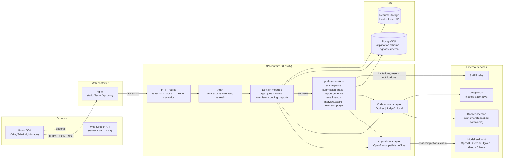
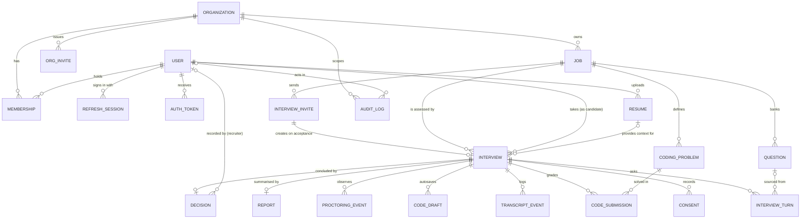
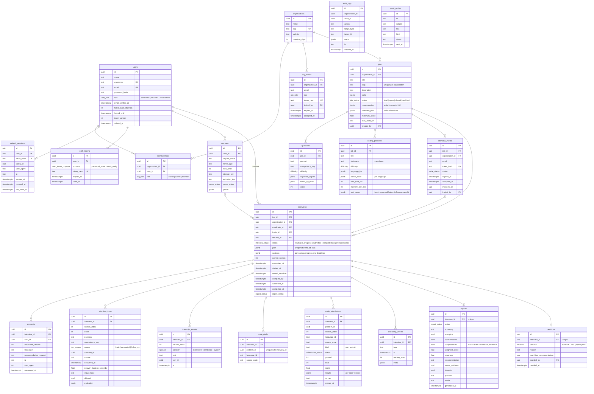
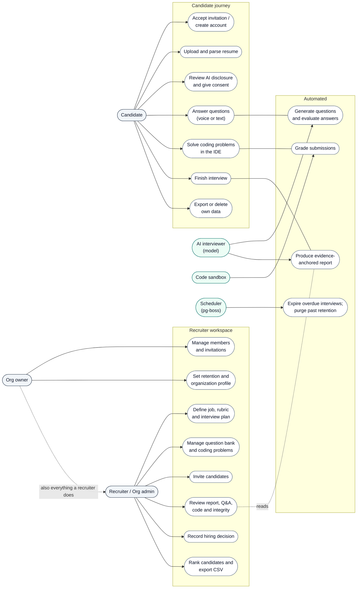

# Diagrams

The diagrams below are written in [Mermaid](https://mermaid.js.org) so they render directly on
GitHub and in most editors, and so they can be reviewed in pull requests like any other text. Each
one lives in its own file under `docs/diagrams/` (source `.mmd` and a rendered `.svg`); this page
embeds the sources. If you change the schema or the architecture, update the matching diagram in
the same change.

To re-render the SVGs:

```bash
npx -y @mermaid-js/mermaid-cli -i docs/diagrams/<name>.mmd -o docs/diagrams/<name>.svg
```

| Diagram | Source | Rendered |
| --- | --- | --- |
| Architecture | [`diagrams/architecture.mmd`](diagrams/architecture.mmd) | [`architecture.svg`](diagrams/architecture.svg) |
| Entity-relationship | [`diagrams/er-diagram.mmd`](diagrams/er-diagram.mmd) | [`er-diagram.svg`](diagrams/er-diagram.svg) |
| Database schema | [`diagrams/db-diagram.mmd`](diagrams/db-diagram.mmd) | [`db-diagram.svg`](diagrams/db-diagram.svg) |
| Use cases | [`diagrams/use-case-diagram.mmd`](diagrams/use-case-diagram.mmd) | [`use-case-diagram.svg`](diagrams/use-case-diagram.svg) |

## 1. Architecture

How the deployable pieces fit together, including the external services the API talks to and
the background workers that share the API process.



## 2. Entity-relationship diagram

The conceptual model: which entities exist and how they relate. Cardinalities read left to right.



## 3. Database diagram

The physical schema as implemented in `apps/api/src/db/schema.ts`: tables, key columns and types.
Secondary columns such as `created_at` and `updated_at` are omitted where they carry no meaning.



## 4. Use case diagram

Actors and what each can do. The AI interviewer and the sandbox are shown as system actors
because they take part in interactions without being users.


